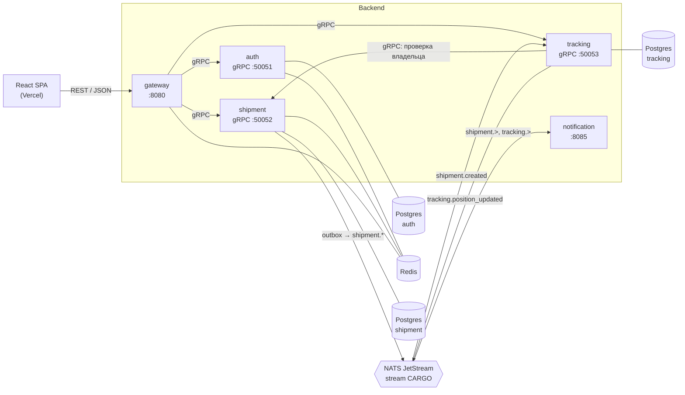

# CargoFlow

Бэкенд системы трекинга грузоперевозок: заявки на перевозку вагонов и контейнеров, смена статусов, история перемещений, уведомления.

Пет-проект, на котором показаны микросервисы на Go: **gRPC** между сервисами, **REST** для фронта через grpc-gateway, event-driven на **NATS JetStream** с transactional outbox, **Postgres** + **Redis**, сквозной трейсинг через **OpenTelemetry**.

Фронтенд (React + TypeScript, Vercel) живёт отдельно и получает от бэкенда REST API и OpenAPI-спецификацию.

## Архитектура



| Сервис | Порт локально | Хранилище | Ответственность |
|---|---|---|---|
| gateway | HTTP 8080 | Redis (rate limit) | REST→gRPC, проверка JWT, CORS, rate limit, `/openapi.json` |
| auth | gRPC 50051, HTTP 8081 | Postgres `auth`, Redis | регистрация, логин, refresh, валидация токена |
| shipment | gRPC 50052, HTTP 8082 | Postgres `shipment`, Redis | заявки и статусы, outbox → NATS |
| tracking | gRPC 50053, HTTP 8083 | Postgres `tracking` | точки маршрута, история перемещений |
| notification | HTTP 8085 | — | слушает NATS, отправляет уведомления (заглушки) |

HTTP-порты 8081–8085 отдают только `/healthz` и `/readyz`.

Подробности — в [docs/ARCHITECTURE.md](docs/ARCHITECTURE.md), библиотеки и примеры кода — в [docs/LIBRARIES.md](docs/LIBRARIES.md).

## Быстрый старт

Нужны Go 1.26+ (при `GOTOOLCHAIN=auto` подтянется сам), [buf](https://buf.build/docs/installation), Docker и make (на Windows — из Git Bash или scoop).

```bash
cp .env.example .env   # подставь значения из комментариев «локально:» (если .env ещё нет)
make tools             # проверка buf/docker, сборка go-tools из go.mod
make infra-up          # Postgres, Redis, NATS, Jaeger
make migrate-up        # миграции auth, shipment и tracking
make apps-up           # все 5 сервисов в Docker
```

Есть три способа запустить сервисы, отдельный терминал на каждый сервис не нужен:

| Способ | Команда | Когда удобно |
|---|---|---|
| Все в Docker | `make apps-up`, логи — `make apps-logs`, остановка — `make infra-down` | просто поднять бэкенд для фронта |
| Все из исходников в одном терминале | `make run-all` (Ctrl+C останавливает все) | правишь Go-код: перезапуск собирает свежие бинарники |
| Один сервис из исходников | `make run-shipment` | отлаживаешь один сервис, остальные в Docker или в `run-all` |

Если один сервис запущен из исходников, а остальные в Docker, сначала останови его контейнер, иначе порт будет занят: `docker compose -f deploy/docker-compose.yml stop shipment`.

Проверка: `curl localhost:8080/readyz` → `{"auth":"ok","redis":"ok","shipment":"ok","tracking":"ok"}`.

| Что | Адрес |
|---|---|
| REST API | http://localhost:8080 |
| OpenAPI-спецификация | http://localhost:8080/openapi.json |
| Jaeger UI (трейсы) | http://localhost:16686 |
| NATS monitoring | http://localhost:8222 |
| Postgres | `localhost:5434`, пользователь `cargo` / `cargo` |

Postgres проброшен на **5434**, потому что 5432 часто занят локально установленным PostgreSQL.

## REST API

Все ответы — JSON. Защищённые эндпоинты требуют `Authorization: Bearer <accessToken>`.

| Метод | Путь | Auth | Описание |
|---|---|---|---|
| POST | `/v1/auth/register` | — | регистрация (`email`, `password` ≥ 8 символов) |
| POST | `/v1/auth/login` | — | пара токенов `accessToken` / `refreshToken` |
| POST | `/v1/auth/refresh` | — | ротация refresh-токена (старый становится недействительным) |
| POST | `/v1/shipments` | ✓ | создать заявку (`cargoType`, `origin`, `destination`) |
| GET | `/v1/shipments` | ✓ | мои заявки, новые первыми (`?pageSize=20`, максимум 100) |
| GET | `/v1/shipments/{id}` | ✓ | заявка по ID |
| PATCH | `/v1/shipments/{id}/status` | ✓ | смена статуса: `CREATED → IN_TRANSIT → DELIVERED`, отмена из первых двух |
| POST | `/v1/shipments/{shipmentId}/positions` | ✓ | отметить прохождение станции (`station`, `lat`, `lon`) |
| GET | `/v1/shipments/{shipmentId}/route` | ✓ | история маршрута |
| GET | `/openapi.json` | — | OpenAPI-спецификация (Swagger 2.0) |
| GET | `/healthz`, `/readyz` | — | liveness и readiness |

Значения перечислений передаются строками: `CARGO_TYPE_WAGON`, `CARGO_TYPE_CONTAINER`, `SHIPMENT_STATUS_IN_TRANSIT` и т.д. Поля в JSON — в camelCase.

### Ошибки

Единый формат grpc-gateway, gRPC-коды стандартно отображаются в HTTP:

```json
{"code": 3, "message": "invalid input: email is not valid", "details": []}
```

| gRPC code | HTTP | Когда |
|---|---|---|
| 3 `INVALID_ARGUMENT` | 400 | ошибка валидации |
| 16 `UNAUTHENTICATED` | 401 | нет токена, токен истёк, неверный пароль |
| 5 `NOT_FOUND` | 404 | нет заявки (или она чужая) |
| 6 `ALREADY_EXISTS` | 409 | email уже зарегистрирован |
| 9 `FAILED_PRECONDITION` | 400 | недопустимый переход статуса |
| 8 `RESOURCE_EXHAUSTED` | 429 | превышен rate limit |
| 14 `UNAVAILABLE` | 503 | недоступен внутренний сервис |

### Примеры curl

```bash
# регистрация
curl -s -X POST localhost:8080/v1/auth/register \
  -H 'Content-Type: application/json' \
  -d '{"email":"demo@cargoflow.dev","password":"password123"}'

# логин → сохраняем access token
TOKEN=$(curl -s -X POST localhost:8080/v1/auth/login \
  -H 'Content-Type: application/json' \
  -d '{"email":"demo@cargoflow.dev","password":"password123"}' | jq -r .tokens.accessToken)

# создание заявки
curl -s -X POST localhost:8080/v1/shipments \
  -H "Authorization: Bearer $TOKEN" -H 'Content-Type: application/json' \
  -d '{"cargoType":"CARGO_TYPE_CONTAINER","origin":"Astana-1","destination":"Almaty-2"}'

# маршрут: первую точку (станцию отправления) tracking добавил сам по событию shipment.created
curl -s localhost:8080/v1/shipments/<id>/route -H "Authorization: Bearer $TOKEN"
```

После создания заявки в логах notification появится `"msg":"notification","title":"Shipment created"`, а в Jaeger — один трейс: `gateway → shipment → publish shipment.created → process shipment.created` в tracking и notification.

### Типы для фронта

`protoc-gen-openapiv2` генерирует Swagger 2.0. `openapi-typescript` v7 принимает только OpenAPI 3, поэтому сначала сконвертируй спецификацию:

```bash
npx swagger2openapi http://localhost:8080/openapi.json -o openapi.json
npx openapi-typescript openapi.json -o src/api/schema.d.ts
```

CORS разрешён для origin из `CORS_ALLOWED_ORIGINS` (по умолчанию `http://localhost:5173` — Vite).

## Разработка

| Команда | Что делает |
|---|---|
| `make proto` | `buf lint` + генерация Go-кода, gRPC, gateway и OpenAPI в `gen/` |
| `make sqlc` | генерация типобезопасного кода из `services/*/queries/*.sql` |
| `make migrate-up` / `migrate-down` / `migrate-status` | миграции goose для auth, shipment и tracking |
| `make infra-up` / `infra-down` / `infra-reset` | инфраструктура в Docker (`reset` удаляет данные) |
| `make apps-up` / `make apps-logs` | собрать образы и поднять все сервисы в Docker / смотреть их логи |
| `make run-all` | все сервисы из исходников в одном терминале |
| `make run-<service>` | запустить один сервис из исходников |
| `make test` / `make test-integration` | unit-тесты / интеграционные на testcontainers (Postgres) |
| `make lint` | buf lint, go vet, golangci-lint |
| `make build` / `make docker-build` | бинарники в `bin/` / Docker-образы |

Сгенерированный код (`gen/`, `services/*/internal/repository/db/`) коммитится; CI проверяет, что он совпадает с результатом генерации.

Конфигурация — только через переменные окружения, полный список с комментариями — в [.env.example](.env.example). При локальном запуске сервисы сами читают `.env` из корня репозитория.

## Деплой

| Компонент | Где |
|---|---|
| Go-сервисы | Render, Docker, Blueprint [deploy/render.yaml](deploy/render.yaml) |
| Postgres | Neon (отдельная БД на сервис: `auth`, `shipment`, `tracking`) |
| Redis | Upstash / Render Key Value |
| NATS | Synadia Cloud (free) |
| Трейсы | OTLP-коллектор (см. [ARCHITECTURE.md](docs/ARCHITECTURE.md#трейсинг)) |

С `MIGRATE_ON_START=true` сервисы сами накатывают встроенные в бинарник миграции (под advisory lock).

## Документация

- [docs/learning/](docs/learning/README.md) — короткий курс по проекту для фронтендера: Go, gRPC, структура, путь запроса.
- [docs/ARCHITECTURE.md](docs/ARCHITECTURE.md) — сервисы, границы данных, события, outbox, трейсинг, безопасность.
- [docs/LIBRARIES.md](docs/LIBRARIES.md) — зависимости и примеры их использования в коде проекта.
